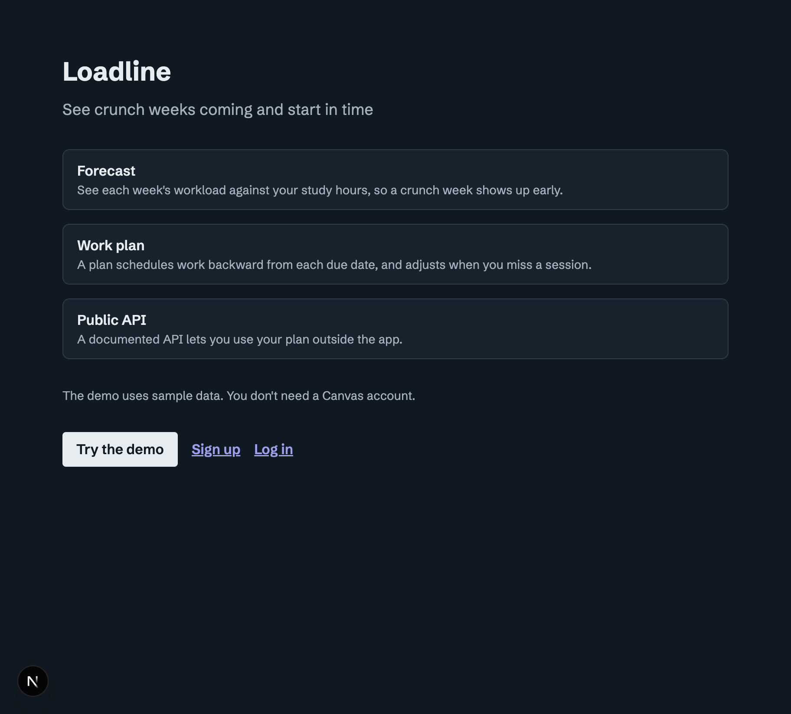
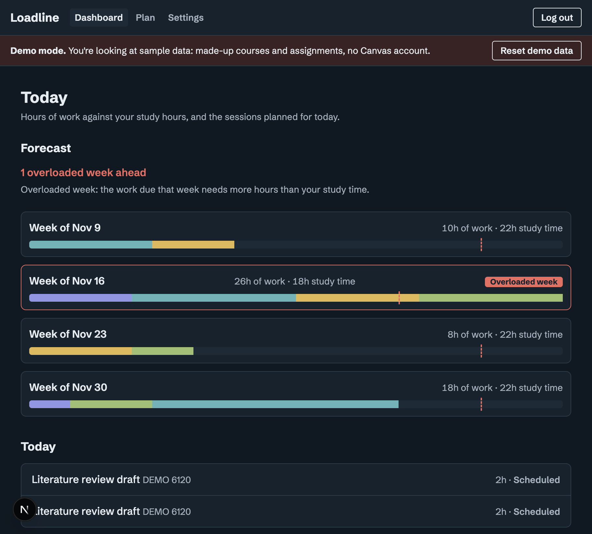
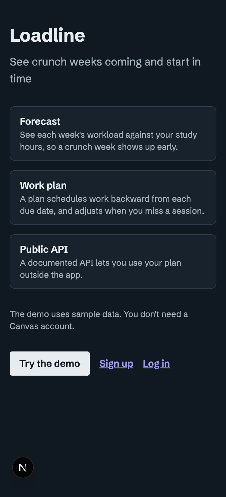
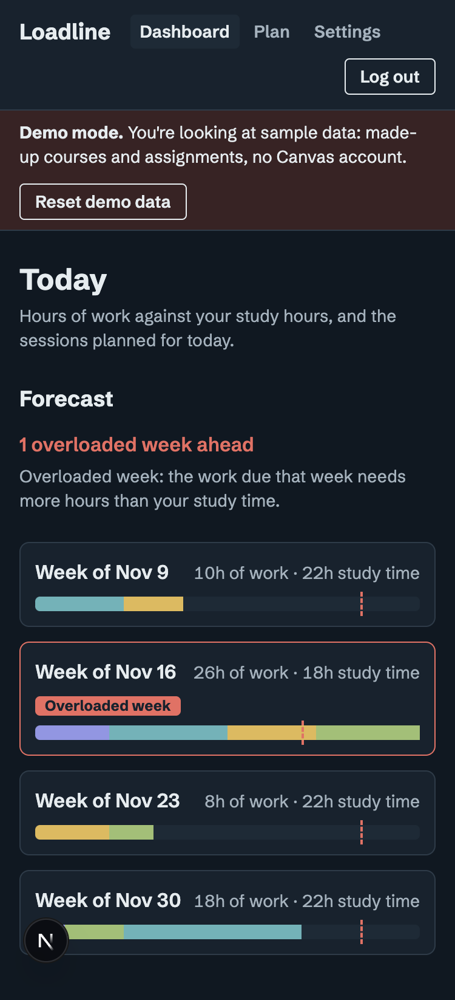

# Loadline

Loadline turns course deadlines into a calm plan. It shows which weeks will
be overloaded (more work due than you have study time for), and splits each
assignment into daily work sessions that fit the study hours you set.

**Live app:** https://loadline-cs6983-loadline1.vercel.app. Click **Try the
demo** to look around with sample data; no account or Canvas login needed.

Pair project for CS 6983 (AI Coding), Fall 2026, by
[@ch3nxi1iu](https://github.com/ch3nxi1iu) and [@brandy-wang](https://github.com/brandy-wang).

Stack: Next.js 16 (App Router, TypeScript) · Tailwind CSS 4 · PostgreSQL with
Prisma 7 · Vitest + Testing Library · Vercel + Neon.

## What it does

| Feature | Story | Where |
|---|---|---|
| Sign up and sign in; the session is a JWT in an httpOnly cookie | [US-01](https://github.com/ch3nxi1iu/CS6983Project2/issues/7) | `/register`, `/login` |
| Demo mode: a demo account with sample courses and assignments, a "Demo mode" banner, and a button to reset the sample data | [US-04](https://github.com/ch3nxi1iu/CS6983Project2/issues/10) | **Try the demo** on `/` |
| Dashboard: the forecast and today's work sessions on one page | [US-05](https://github.com/ch3nxi1iu/CS6983Project2/issues/11), [US-07](https://github.com/ch3nxi1iu/CS6983Project2/issues/13) | `/dashboard` |
| Workload forecast: for each of the next 4 weeks, the hours of work due against your study time; weeks where the work needs more hours than your study time are marked **Overloaded week** | [US-05](https://github.com/ch3nxi1iu/CS6983Project2/issues/11) | `/dashboard`, `GET /api/workload` |
| Weekly study hours and days off; changing them re-plans | [US-06](https://github.com/ch3nxi1iu/CS6983Project2/issues/12) | `/settings/availability` |
| Work plan: each assignment split into sessions before its due date, with at-risk warnings | [US-07](https://github.com/ch3nxi1iu/CS6983Project2/issues/13) | `/plan` |
| Public REST API with personal API keys and interactive docs | [US-12](https://github.com/ch3nxi1iu/CS6983Project2/issues/18) | `/docs/api`, `/settings/api` |

Not built in this project: connecting a real Canvas account (US-02, US-03; demo
data stands in for it), study groups and live group progress (US-10, US-11), and
the stretch stories. The [PRD](docs/PRD.md) lists every story.

## Screenshots

| Landing page | Dashboard in demo mode |
|---|---|
|  |  |

On a phone, the same pages stack into one column:

 

## Run it locally

Requires Node.js 22 or newer (CI uses 24).

```bash
git clone https://github.com/ch3nxi1iu/CS6983Project2.git
cd CS6983Project2
npm install            # also generates the Prisma client
cp .env.example .env
```

Then fill in `.env`:

1. **Database.** In a second terminal, run `npx prisma dev`. It starts a local
   Postgres and prints its connection strings; copy the **TCP** one
   (`postgres://…@localhost:…`) into `DATABASE_URL`. Any other Postgres URL
   works too.
2. **Session secret.** Run `openssl rand -base64 32` and paste the result into
   `AUTH_SECRET`.

Create the tables and start the app:

```bash
npx prisma migrate deploy
npm run dev            # http://localhost:3000
```

Click **Try the demo** on the home page to get a demo account with sample
data, or create an account at `/register`, set your study hours on
`/settings/availability`, and open `/plan`.

### Environment variables

| Variable | Needed | What it's for |
|---|---|---|
| `DATABASE_URL` | Always | Postgres connection used by the app (Neon's pooled URL in production) |
| `DATABASE_URL_UNPOOLED` | Vercel only | Direct connection used by migrations; Neon's Vercel integration sets it |
| `AUTH_SECRET` | Always, except in tests | Signs session JWTs and keys the API key hashes. Changing it signs everyone out and invalidates every API key |

`.env` is gitignored. Never commit real values.

## Tests

```bash
npm test               # unit and integration tests
npm run test:coverage  # the same tests, with a coverage report
```

Integration tests use the database in `DATABASE_URL`, so run
`npx prisma migrate deploy` first. Planner, forecast, and availability rules
are pure functions in `src/lib/planner/` and are tested without a database.

Coverage of `src/lib` and `src/app/api` on 2026-11-14: 94.94% statements,
90.2% branches, 99.2% functions, 95.54% lines. CI runs
`npm run test:coverage` on every PR and shows the coverage table on the run's
summary page; the run fails if line coverage drops below 80%.

| Command | What it does |
|---|---|
| `npm run dev` | Start the dev server |
| `npm test` | Run all tests once |
| `npm run test:watch` | Run tests in watch mode |
| `npm run test:coverage` | Run all tests once and report coverage of `src/lib` and `src/app/api` |
| `npm run lint` | Lint with ESLint |
| `npm run typecheck` | Generate Next.js route types and type-check |
| `npm run build` | Production build |
| `npm run vercel-build` | What Vercel runs: migrations (production only), then the build |

## Public API

Sign in, open `/settings/api`, and create a key (it's shown once). Then:

```bash
curl -H "Authorization: Bearer $LOADLINE_API_KEY" \
  https://loadline-cs6983-loadline1.vercel.app/api/tasks
```

| Endpoint | Returns |
|---|---|
| `GET /api/tasks` | Your open assignments |
| `GET /api/plan/today` | Today's work sessions |
| `GET /api/workload` | The weekly workload forecast |
| `POST /api/work-sessions/{id}/complete` | Marks a session done |

Each caller can make 60 requests a minute; more returns `429` with
`Retry-After`. Try every endpoint in the browser at
[`/docs/api`](https://loadline-cs6983-loadline1.vercel.app/docs/api); the
OpenAPI 3.1 spec is at
[`/openapi.json`](https://loadline-cs6983-loadline1.vercel.app/openapi.json).

## Deployment and CI/CD

The app runs on [Vercel](https://vercel.com) with a [Neon](https://neon.tech)
Postgres database, connected to this repo.

| Environment | Where | Database | Migrations |
|---|---|---|---|
| Local | `npm run dev` | Your own (e.g. `npx prisma dev`) | `npx prisma migrate deploy`, by hand |
| Preview | A URL Vercel posts on each PR | The same Neon database as production | Not run, so an unmerged migration can't change it |
| Production | The live URL above | Neon | `prisma migrate deploy` runs before every production build |

| Event | What happens |
|---|---|
| Pull request opened or updated | GitHub Actions runs lint and typecheck → tests on a fresh Postgres 16 with all migrations applied → build, plus `npm audit` and CodeQL. Vercel builds a preview |
| Review | The other partner reviews the PR, as [AGENTS.md](AGENTS.md) requires |
| Merge to `main` | Allowed only when the five required checks pass. Vercel then deploys to production |

Environment variables live in Vercel (Project → Settings → Environment
Variables), never in the repo. Diagrams of the system and the pipeline are in
[docs/architecture.md](docs/architecture.md).

## Documentation

- [Product requirements](docs/PRD.md): problem, users, stories, and sprints
- [Architecture](docs/architecture.md): system and delivery pipeline diagrams
- [Database schema](docs/database.md): tables, relations, and constraints
- [AGENTS.md](AGENTS.md): the shared rules file both partners' AI tools follow
- [Sprint 1](docs/sprints/sprint-1.md) and [Sprint 2](docs/sprints/sprint-2.md): plans, standups, and retrospectives
- [Contribution log](docs/contributions.md): who did what
- [AI usage log](docs/ai-usage.md): which AI tool did what, PR by PR
- [Mockup](docs/mockups/loadline-mockup.html): interactive desktop and mobile mockup; open it in a browser
