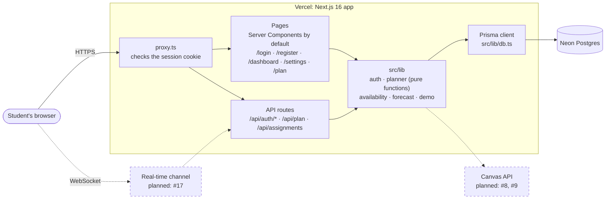
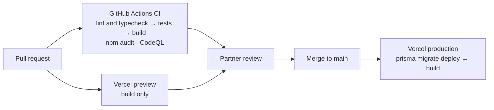

# Architecture

Loadline is one Next.js app on Vercel, backed by a Neon Postgres database.
Dashed boxes are planned but not built yet.

## System

- **Frontend:** React Server Components render on the server. Only interactive
  parts (forms, steppers, buttons) are Client Components.
- **API:** route handlers in `src/app/api/` validate input, call `src/lib`, and
  return JSON. Errors use one shape: `{ "error": { "code", "message" } }`.
- **Auth:** `proxy.ts` runs before every request. Signed-out users are sent
  from `/dashboard` and `/settings` to `/login`, and `/api` routes (except
  `/api/auth/*`) return 401. The session is a JWT in an httpOnly cookie.
- **Logic:** scheduling, forecast, and availability math live in
  `src/lib/planner/` as pure functions, so they're tested without a database.
- **Database:** every query goes through the one Prisma client in
  `src/lib/db.ts`. See [database.md](database.md) for the tables.
- **Canvas (planned):** all Canvas calls will go through `src/lib/canvas/`.
  Until then, demo mode supplies sample courses and assignments.
- **Real-time (planned):** live group progress would add a WebSocket channel.

## Delivery pipeline

`main` is protected: a PR can't merge until the five CI checks pass.
