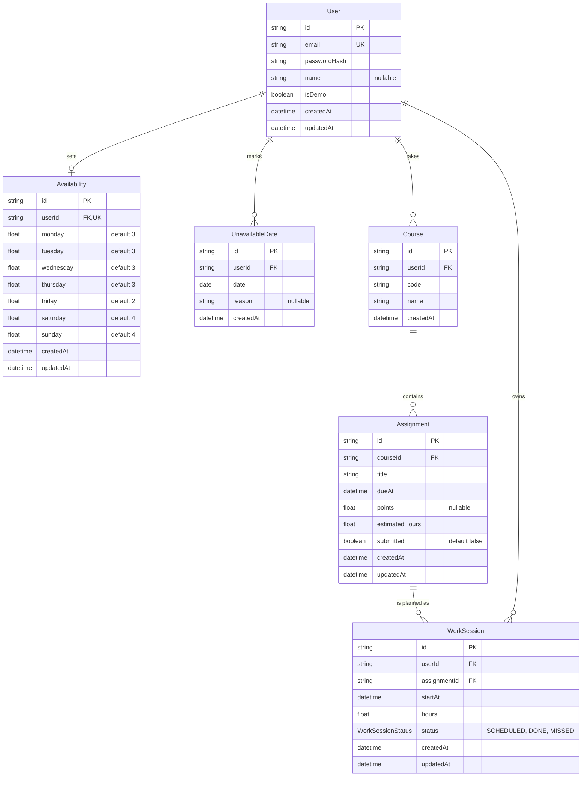

# Database schema

PostgreSQL on Neon, managed with Prisma. The source of truth is
[`prisma/schema.prisma`](../prisma/schema.prisma); change it only with
`npx prisma migrate dev`, and update this diagram in the same PR.

Rules the diagram can't show:
- **Unique together:** one `UnavailableDate` per user per date, and one
  `Course` per user per course code.
- **Deletes cascade:** deleting a user deletes all their rows; deleting a
  course deletes its assignments and their work sessions.
- **Indexes:** `Assignment(courseId, dueAt)` and `WorkSession(userId, startAt)`,
  for the forecast's and the work plan's main lookups.
- **Units:** all times are UTC; all durations are hours. `UnavailableDate.date`
  is a date with no time.
