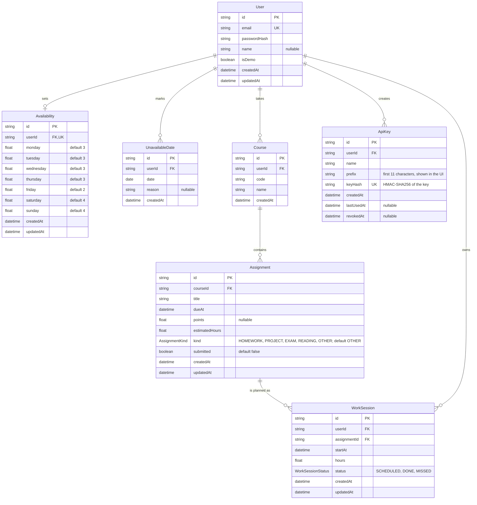

# Database schema

PostgreSQL on Neon, managed with Prisma. The source of truth is
[`prisma/schema.prisma`](../prisma/schema.prisma); change it only with
`npx prisma migrate dev`, and update this diagram in the same PR.

Rules the diagram can't show:
- **Unique together:** one `UnavailableDate` per user per date, and one
  `Course` per user per course code.
- **Deletes cascade:** deleting a user deletes all their rows (including API
  keys); deleting a course deletes its assignments and their work sessions.
- **Indexes:** `Assignment(courseId, dueAt)` and `WorkSession(userId, startAt)`,
  for the forecast's and the work plan's main lookups; `ApiKey(userId)` for
  the keys page.
- **API keys are never stored in plain text:** only an HMAC-SHA256 of the key,
  keyed with `AUTH_SECRET`, plus a short display prefix. A revoked key keeps
  its row with `revokedAt` set. Changing `AUTH_SECRET` invalidates every key.
- **Assignment kind** sets the default estimate when `estimatedHours` isn't
  known (see `DEFAULT_HOURS_BY_KIND` in `src/lib/planner/work-plan.ts`).
- **Units:** all times are UTC; all durations are hours. `UnavailableDate.date`
  is a date with no time.
